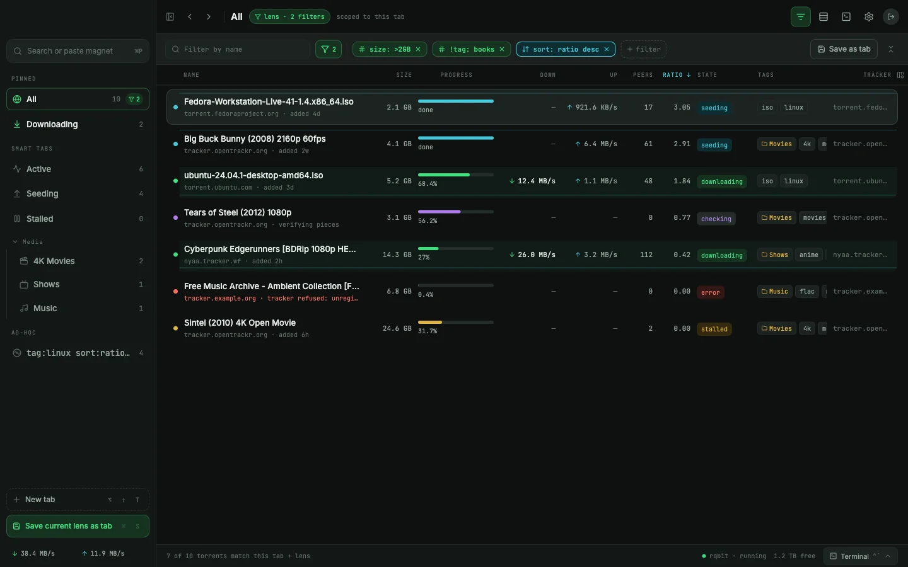
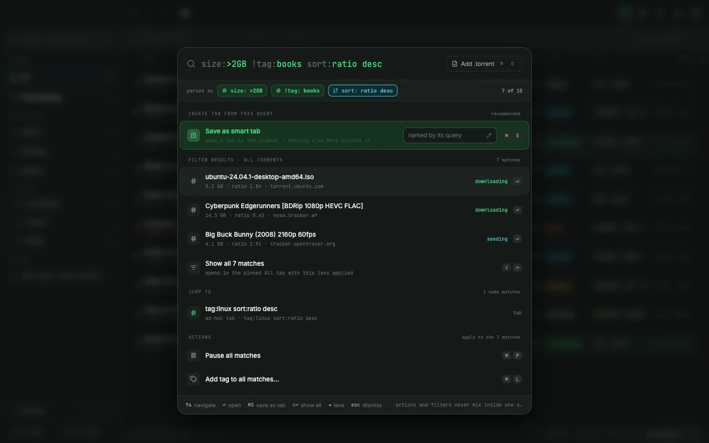
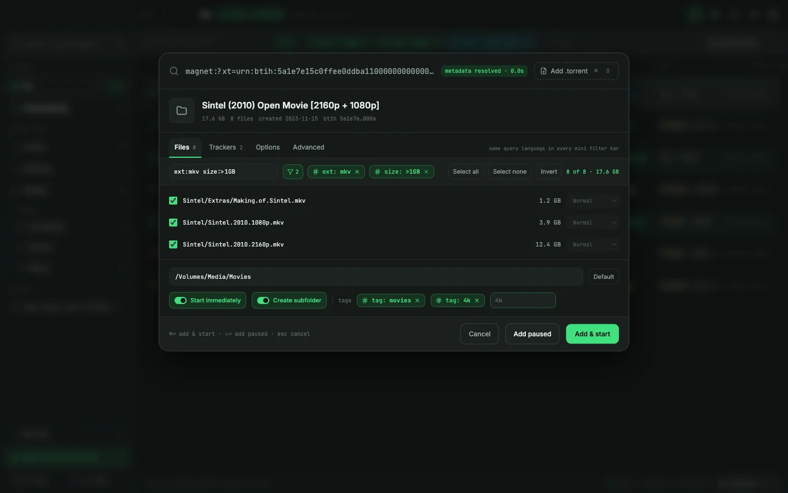
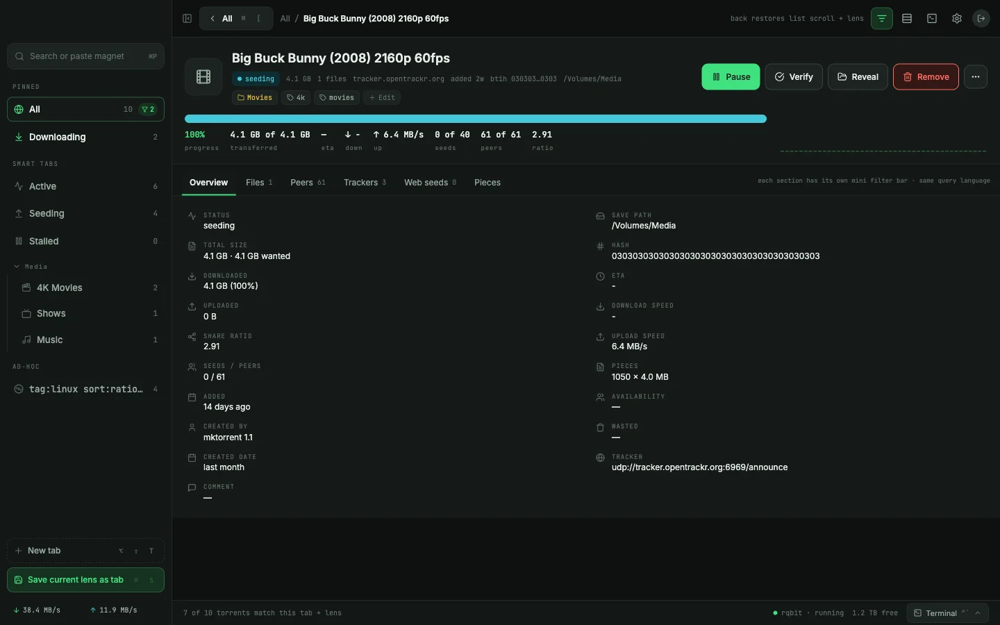
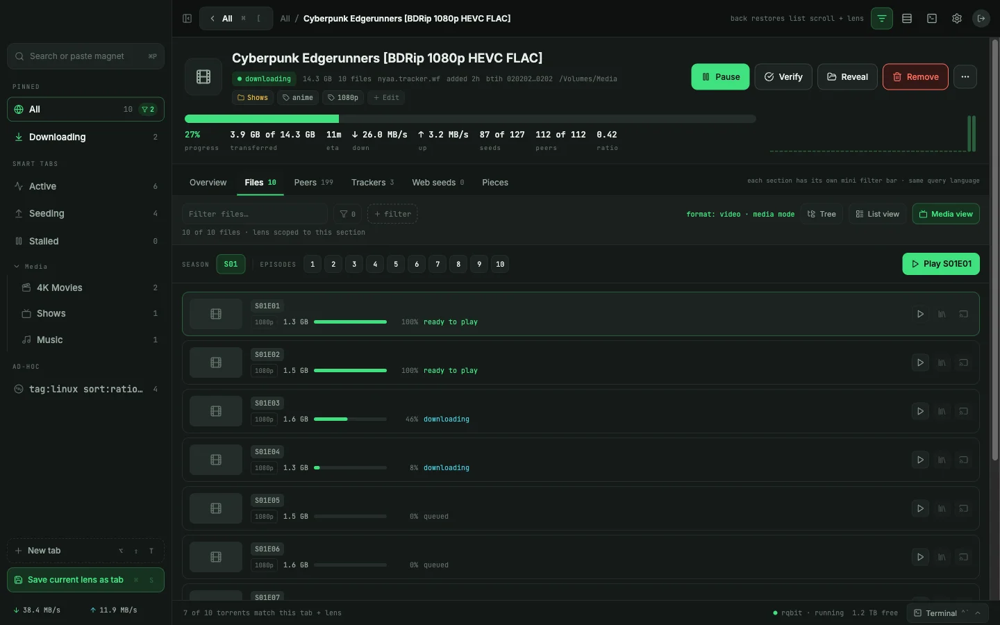
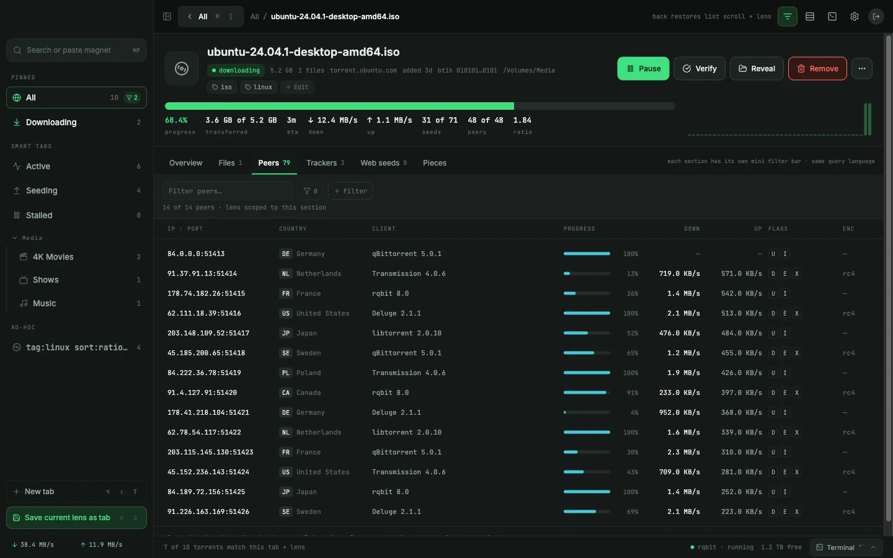
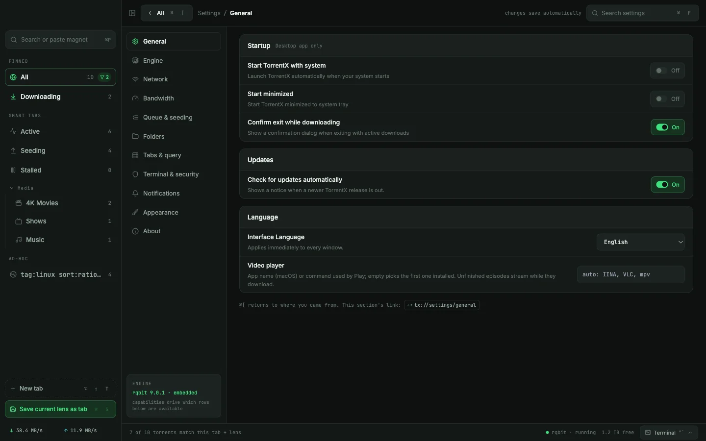

# TorrentX

A torrent client with a terminal-style UI, built around one query language. One server, two ways to run it:

- **Desktop app** (macOS / Windows / Linux): a tray app. It runs the TorrentX server
  inside its own process and shows the web UI in a frameless window. Click the tray icon to
  show or hide it, or open `http://localhost:9977` in any browser.
- **Headless server** (`torrentx-server`): a single binary for a Linux box. It runs
  as a systemd service; you manage it from a browser or over the HTTP API.
  See [docs/linux-service.md](docs/linux-service.md).

Engines: the built-in **rqbit** engine (no external daemon), or an existing
**Transmission** daemon over RPC. You pick one in Settings.



<sub>Screenshots show the real UI with a sample library.</sub>

## Features

### Tabs, lenses and one query language

Everything that filters or sorts the list is query text: `state:active tag:4k size:>4GB sort:ratio desc`.

- **Query language**: `field:value` or the prefix form `:field value`, negation `!`, comparisons `> < >= <=`,
  ranges `a..b`, quoted phrases, `*` wildcards, implicit AND, `AND` / `OR`, one level of `( )`, and `sort:` as a
  predicate. Fields: name, state, tag, category, tracker, size, progress, ratio, seeds, peers, down, up, eta, added.
  Errors point at the exact column and suggest a fix.
- **Tabs are saved queries.** Built-in tabs (All, Downloading, Active, Seeding, Stalled), plus your own: pinned,
  grouped in folders, or ad-hoc tabs named by their query. Sidebar icons follow what a tab holds (state, movies,
  shows, music, books, disc images).
- **Lens**: filter chips ANDed onto the active tab. Add, negate, reorder or remove chips, undo with ⌘Z, and save
  the lens as a new tab. On a tab you made, edits are written back to the tab itself.
- **Filter builder**: build the same query with ALL / ANY rows, a nested OR group and a sort.
- Column headers edit the `sort:` chip. When nothing matches, the bar shows which predicate emptied the list.

### Spotlight



One panel (⌘T) for everything:

- Jump to torrents, tabs and files; `>` runs any command; `@` searches files across all torrents.
- Type a query and it is drawn as tokens with completions; create a tab from it (⌘S), see the matches,
  show them all (⇧⏎), apply it as a lens (⇥), or pause or tag every match at once.
- Paste a magnet link or `.torrent` URL to add it.

### Adding torrents



Paste a magnet or URL, press ⌘O, or drop a `.torrent` file on the window. Metadata is resolved before you add,
so you can pick files (with the same query language in a mini filter bar), choose the save folder, set tags,
and start now or paused.

### The torrent list

- Live progress, speeds, peers, ratio, state, tags, category and tracker for each torrent.
- Click a row to open it; ⌘-click / ⇧-click to select several; keyboard cursor with ↑ ↓ and Enter.
- Drag column borders to resize, reorder columns in a popup; compact rows; collapsible sidebar.
- Tags and one category per torrent, edited from a picker (row menu, tags cell, detail header or ⌘L).
- Pause, resume, remove (with or without data), verify, move data, rename, copy magnet, show in file manager.

### Torrent details

Sections Overview, Files, Peers, Trackers, Web seeds and Pieces, each with its own mini filter bar.



- **Files**: a folder tree with file-type icons, wanted / skip and priority per file or folder, plus a list view.
- **Media view** for season packs: episodes by season with quality tags (2160p, HDR10, DV, Atmos…), parsed from
  file names (`S01E02`, `1x02`, or anime-style `Show - 02`).
- **Play and stream**: a finished episode opens in your video player; an unfinished one streams into it while it
  downloads, pieces near the playhead first (IINA, VLC or mpv, or the player you set). From another device, Play
  copies a stream link to paste into a player there. Streaming needs the built-in engine.

  
- Peers with client and country, tracker status, re-announce, web seeds, piece map, open or reveal files.

  

### Automation and server features

- Queue limits (active downloads / torrents), seeding limits (ratio, time), move completed downloads.
- Speed limits, connection limits, listen port with UPnP and a port test, DHT / PEX / LPD, encryption, proxy.
- Desktop and browser notifications when a torrent is added or finishes; start with the system, start minimized,
  confirm quit while downloading.
- Features an engine lacks are shown disabled with "not supported by <engine>", never faked.

### Everywhere else




- Settings page with search and deep links; changes to the engine apply live.
- A built-in terminal (`list`, `status`, `add`, `pause`, `resume`, `remove`).
- Every action has a command and a keyboard shortcut (cheat sheet with ⌘K); back / forward between views.
- Dark and light themes with accent colors; English, French, German, Spanish, Russian and Chinese.
- Optional login (session cookie or HTTP Basic); Host and Origin checks against DNS rebinding and CSRF.
- Update check against GitHub releases.

## Download

Grab a build from [Releases](https://github.com/torrentx/torrentx/releases), or use these links to the latest version:

- Desktop app: [macOS (universal)](https://github.com/torrentx/torrentx/releases/latest/download/TorrentX-macos-universal.dmg),
  [Windows MSI](https://github.com/torrentx/torrentx/releases/latest/download/TorrentX-windows-x64.msi) /
  [setup.exe](https://github.com/torrentx/torrentx/releases/latest/download/TorrentX-windows-x64-setup.exe),
  [Linux AppImage](https://github.com/torrentx/torrentx/releases/latest/download/TorrentX-linux-x86_64.AppImage) /
  [.deb](https://github.com/torrentx/torrentx/releases/latest/download/TorrentX-linux-amd64.deb)
- Headless server (binary, systemd unit and install guide):
  [Linux x86_64](https://github.com/torrentx/torrentx/releases/latest/download/torrentx-server-linux-x86_64.tar.gz),
  [Linux aarch64](https://github.com/torrentx/torrentx/releases/latest/download/torrentx-server-linux-aarch64.tar.gz)
- `SHA256SUMS.txt`: verify with `sha256sum -c SHA256SUMS.txt`

Builds are not code-signed yet. On macOS, right-click the app and choose **Open** the first time (or run
`xattr -d com.apple.quarantine /Applications/TorrentX.app`); on Windows, choose **More info → Run anyway**.
The [`nightly`](https://github.com/torrentx/torrentx/releases/tag/nightly) pre-release is rebuilt from every push to `main`.

## Quick start

```bash
pnpm install

pnpm dev:desktop        # desktop app (in-process server + tray + window, UI hot-reloads)
pnpm dev:server         # headless server on http://127.0.0.1:9977
pnpm dev:web            # Vite dev UI on :1420, proxies /api to the server above

pnpm build:desktop:macos     # or :windows / :linux; release bundles for that platform
pnpm build:server            # headless server for this machine
```

Every script runs the same from bash, zsh, PowerShell and `cmd`. On Windows, if a port is reported as reserved,
`netsh interface ipv4 show excludedportrange protocol=tcp` lists the ranges Windows (Hyper-V, WinNAT) keeps for
itself; pick a `port` outside them.

If a TorrentX server is already running on the configured port (e.g. the
system service), the desktop app attaches to it instead of starting its own.

## Configuration

A single TOML file, created with defaults on first start:

| Platform | Path |
| --- | --- |
| macOS | `~/Library/Application Support/torrentx/config.toml` |
| Linux | `~/.config/torrentx/config.toml` (service: `/etc/torrentx/config.toml`) |
| Windows | `%APPDATA%\torrentx\config.toml` |

By default the server binds to `127.0.0.1:9977` with no authentication. You
can enable a username/password and change the bind address in **Settings**.
Even without auth, the server rejects requests with a foreign `Host` header
(DNS rebinding) and cross-site writes (CSRF).

## Build

```bash
pnpm build:server       # target/release/torrentx-server (UI embedded)
pnpm build:desktop      # Tauri bundle
pnpm lint
cargo test --workspace
```

## Contributing and releases

Each user-facing pull request adds one change file to `.changeset/` describing the change for the release notes:

```markdown
---
default: minor   # major | minor | patch
---

# Short user-facing title

Optional details.
```

Create it with `knope document-change` ([install Knope](https://knope.tech/installation/)) or by hand. The CI `changes`
check fails without one, unless every commit is a conventional commit such as `ci:` or `docs:`. Merged change files
collect on `main`; a workflow keeps a `release` PR open with the next version and changelog, and merging it builds the
binaries and publishes the versioned release.

## Layout

```
apps/web                Vite shell for the React UI (served by the server)
apps/desktop            Tauri shell (tray + window)
crates/torrentx-core    shared torrent model
crates/torrentx-rqbit   librqbit engine
crates/torrentx-transmission  Transmission RPC engine
crates/torrentx-server  HTTP API + UI hosting (lib + torrentx-server bin)
packages/api-client     typed TS client for /api/v1
packages/query          the query language (parse, evaluate, format)
packages/ui             React components, palette, commands, i18n
packaging/systemd       systemd unit
```
